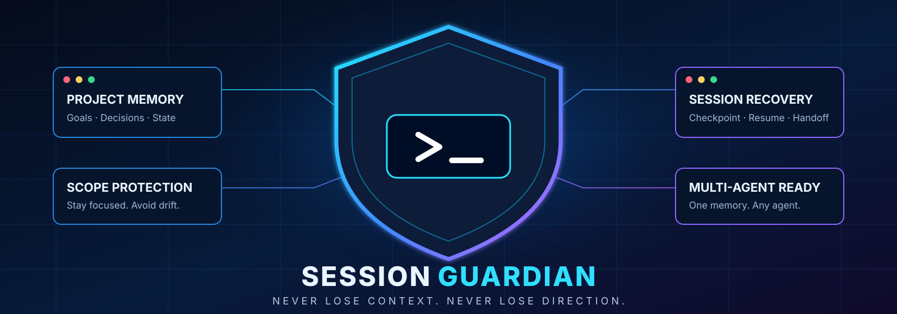

# SessionGuardian

<p align="center">
  
</p>

<p align="center">
  <strong>Never lose context. Never lose direction.</strong><br>
  Agent-agnostic project memory, session recovery, and scope protection.
</p>

SessionGuardian gives AI coding agents a durable, repository-local source of truth for project goals, scope, architecture, decisions, current state, and next actions. The core protocol is plain Markdown, independent of any model vendor.

> **Core principle:** the conversation is temporary; the project's memory belongs to the project.

## Install

### macOS / Linux

One command, no GitHub account required at runtime:

```bash
curl -fsSL https://raw.githubusercontent.com/nirodg/session-guardian/main/install.sh | bash
```

Prefer to inspect before executing?

```bash
curl -fsSLO https://raw.githubusercontent.com/nirodg/session-guardian/main/install.sh
less install.sh
bash install.sh
```

Choose an adapter explicitly:

```bash
curl -fsSL https://raw.githubusercontent.com/nirodg/session-guardian/main/install.sh | bash -s -- --agent codex
```

Supported installer targets currently include Codex, Claude Code, OpenCode, and a generic skills directory. Auto mode installs only into recognized agent skill directories already present; if none are found, it installs the generic skill.

## Quick start

From the project you want to protect:

```bash
session-guardian init
session-guardian status
```

At the beginning of a fresh agent session, ask it to **recover context**. Before ending or switching agents, ask it to **checkpoint**. The skill also instructs the agent to persist meaningful milestones and decisions as work proceeds.

## What it protects

- **Persistent project memory** — goals, scope, architecture, decisions, verified state, and next steps.
- **Session recovery** — actionable handoff for a fresh agent instance.
- **Scope integrity** — out-of-scope ideas are parked, not silently implemented.
- **Reality verification** — reconcile memory against source code, Git state, and test results.
- **Multi-agent continuity** — one portable memory format across supported agents.
- **Safe operation** — preserve user changes; never silently discard work or overwrite existing instructions.

## Memory layout

```text
.session-guardian/
  PROJECT.md
  SCOPE.md
  ARCHITECTURE.md
  DECISIONS.md
  CURRENT_STATE.md
  SESSION_LOG.md
  NEXT_STEPS.md
  checkpoints/
```

Memory is plain Markdown: inspectable, editable, portable, and easy to version with Git. Never store secrets, credentials, private keys, or sensitive personal data in memory files.

## Commands

- `session-guardian init` — create project memory templates without overwriting existing files.
- `session-guardian status` — show memory files and Git working-tree state.
- `session-guardian checkpoint` — create a timestamped snapshot of current memory and Git status.
- `session-guardian recover` — print the recovery checklist.
- `session-guardian doctor` — inspect the local installation.

The coding agent performs the semantic work: reading, reconciling, updating, and applying the scope firewall.

## Important limitation

SessionGuardian is a recovery protocol and agent skill, not a magical process recorder. It can recover only information that was persisted. A hard power loss or forced process kill can lose unsaved editor buffers and uncheckpointed reasoning. Lifecycle hooks and automatic checkpointing are planned adapter capabilities; support must be validated per agent and version.

The repository's actual code and Git state outrank stale memory. SessionGuardian must never claim a task is complete without evidence.

## Roadmap

- [x] Agent-neutral memory protocol and core skill
- [x] Initial project memory templates
- [x] Linux/macOS installer and local helper CLI
- [x] Project branding and SVG hero artwork
- [ ] Native, tested adapters and lifecycle hooks per agent
- [ ] Crash-resilient automatic checkpoint daemon
- [ ] Windows installer and cross-platform test suite
- [ ] Multi-project registry and session discovery

## Contributing

See [CONTRIBUTING.md](CONTRIBUTING.md). New adapters must document installation paths, discovery behavior, lifecycle hooks, upgrades, and reproducible validation.

## License

MIT — see [LICENSE](LICENSE).
