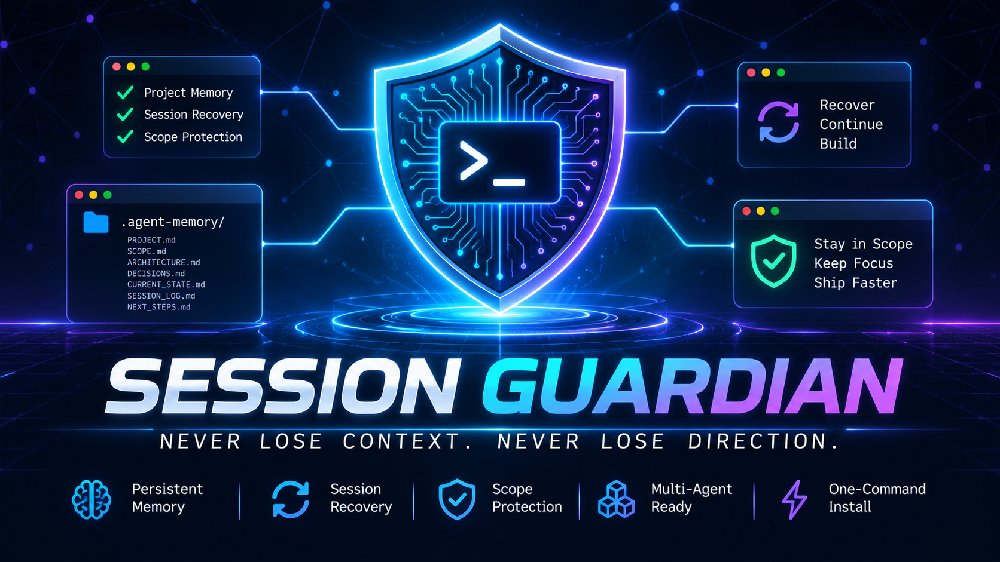

# SessionGuardian

<p align="center">

</p>

<p align="center">
  <strong>Never lose context. Never lose direction.</strong><br>
  Agent-agnostic project memory, session recovery, and scope protection.
</p>

SessionGuardian gives AI coding agents a durable, repository-local source of truth for project goals, scope, architecture, decisions, current state, and next actions. Its core protocol is plain Markdown; its deterministic local engine handles initialization, atomic checkpointing, and integrity verification.

> **Core principle:** the conversation is temporary; the project's memory belongs to the project.

## Install

### macOS / Linux

```bash
curl -fsSL https://raw.githubusercontent.com/nirodg/session-guardian/main/install.sh | bash
```

Prefer to inspect before executing?

```bash
curl -fsSLO https://raw.githubusercontent.com/nirodg/session-guardian/main/install.sh
less install.sh
bash install.sh
```

Choose an adapter explicitly:

```bash
curl -fsSL https://raw.githubusercontent.com/nirodg/session-guardian/main/install.sh | bash -s -- --agent codex
```

The installer currently targets Codex, Claude Code, OpenCode, and a generic skills directory. Auto mode installs only into recognized agent skill directories already present; otherwise it installs the generic skill. Python 3.9+ and Git are required.

## Quick start

From the project you want to protect:

```bash
session-guardian init
session-guardian status
```

At the beginning of a fresh agent session, ask it to **recover context**. Before ending or switching agents, ask it to **checkpoint**.

## Core commands

- `session-guardian init [directory]` — create project memory templates without overwriting existing files; records a project identity and Git fingerprint.
- `session-guardian status [directory]` — show memory files, checkpoints, and Git state.
- `session-guardian checkpoint [directory] [--keep N]` — atomically publish a snapshot with SHA-256 manifest and Git metadata; optionally keep only the N newest valid checkpoints.
- `session-guardian recover [directory] [--checkpoint ID]` — select the newest checkpoint that passes verification (or verify a chosen one), report skipped invalid checkpoints, memory changed since that checkpoint, and Git drift. Never rolls back working files.
- `session-guardian audit [directory]` — verify memory files, project identity, and every checkpoint; exits 1 on problems.
- `session-guardian prune [directory] --keep N` — delete the oldest valid checkpoints beyond N.
- `session-guardian doctor` — inspect Python, core installation, and supported manifest formats.

All commands print JSON. Usage errors exit 2 with a message on stderr.

## Core engine guarantees

- **Atomic checkpoints.** A checkpoint is built in `checkpoints/.staging-*` and published with one directory rename. A crash, kill, or full disk mid-checkpoint never produces a visible checkpoint and never replaces an earlier one. Leftovers are reported by `audit` and removed by the next `checkpoint` or `prune`.
- **Consistent hashes.** Each memory file is read once; the stored bytes and the recorded hash come from the same read. Files are fsynced before publishing.
- **Locking.** Mutating and verifying commands hold an OS lock on `.session-guardian/.lock` (`flock` on POSIX, `msvcrt.locking` on Windows). The OS releases it if the holder dies, so a crash cannot leave a stuck lock. Commands wait up to `--lock-timeout` seconds (default 30).
- **Never overwrite memory.** `init` creates missing files with an exclusive create; existing files are left untouched. `recover` is read-only.
- **Verified recovery points.** Verification checks manifest format, allowed file names (no path traversal), sizes, SHA-256 hashes, unlisted files, and that the checkpoint belongs to this project.
- **Corruption and conflict detection.** `audit` reports missing, empty, non-UTF-8, or NUL-containing memory files; unresolved Git merge-conflict markers; an invalid `identity.json`; and memory copied from a different Git repository (root-commit fingerprint mismatch).
- **Versioned formats.** Manifests carry `format_version` (currently 2). Older manifests (v1) are read and verified in place without rewriting; manifests from a newer SessionGuardian are rejected with an upgrade hint rather than misread.

### Retention

Retention is off by default: SessionGuardian never deletes checkpoints unless asked. Enable it per project in `.session-guardian/config.json`:

```json
{ "retention": { "keep": 20 } }
```

or per run with `checkpoint --keep N` (`0` = unlimited). Pruning counts only checkpoints that pass verification; invalid checkpoints are kept for inspection.

## Memory layout

```text
.session-guardian/
  identity.json        # project_id + Git root-commit fingerprint
  config.json          # optional (retention)
  .gitignore           # ignores runtime files below
  .lock                # runtime lock file
  PROJECT.md
  SCOPE.md
  ARCHITECTURE.md
  DECISIONS.md
  CURRENT_STATE.md
  SESSION_LOG.md
  NEXT_STEPS.md
  LATEST
  checkpoints/
    <YYYYMMDDTHHMMSS_ffffffZ>/
      manifest.json
      *.md
```

Memory is plain Markdown: inspectable, editable, portable, and easy to version with Git. Never store secrets, credentials, private keys, or sensitive personal data in memory files.

## What it protects

- **Persistent project memory** — goals, scope, architecture, decisions, verified state, and next steps.
- **Session recovery** — actionable handoff for a fresh agent instance.
- **Scope integrity** — out-of-scope ideas are parked, not silently implemented.
- **Reality verification** — reconcile memory against source code, Git state, and test results.
- **Checkpoint integrity** — atomic file replacement and SHA-256 verification of stored snapshots.
- **Multi-agent continuity** — one portable memory format across supported agents.

## Important limitations

SessionGuardian is not a magical process recorder. It can recover only information that was persisted. A hard power loss or forced process kill can lose unsaved editor buffers and uncheckpointed reasoning. The current core snapshots memory files; it does not capture terminal scrollback, editor buffers, or live agent internals. If an agent is writing a memory file at the exact moment of a checkpoint, the snapshot may contain that partial content (it will still verify, because it is hashed as read); keep agent writes and checkpoints sequential. Directory fsync is not available on Windows, so the publish rename there is atomic but its durability across power loss depends on the filesystem. Lifecycle hooks and automatic checkpointing remain future work and must be validated per agent and version.

The repository's actual code and Git state outrank stale memory. SessionGuardian never restores or overwrites working files automatically.

## Development

Run the standard-library test suite:

```bash
python -m unittest discover -s tests -v
```

CI is configured for Linux, macOS, and Windows across Python 3.9 and 3.12. The suite includes tests that kill a real process while it holds the lock and while it is mid-checkpoint.

## Roadmap

The full plan lives in [docs/ROADMAP.md](docs/ROADMAP.md). Summary:

- [x] Agent-neutral memory protocol and core skill
- [x] Memory templates and non-destructive initialization
- [x] Python standard-library core engine
- [x] Atomic checkpoint snapshots and SHA-256 integrity audit
- [x] Crash-safe publishing, OS-level locking, verified recovery-point selection, retention, manifest versioning, identity fingerprinting
- [x] Linux/macOS installer
- [x] Initial cross-platform CI matrix
- [ ] Run and fix the CI matrix; validate installer on clean machines
- [ ] Native agent lifecycle hooks and automatic checkpoints
- [ ] Windows-native installer and polished agent adapters
- [ ] Multi-project registry and session discovery
- [ ] Crash-resilient background checkpoint service

## Contributing

See [CONTRIBUTING.md](CONTRIBUTING.md). New adapters must document installation paths, discovery behavior, lifecycle hooks, upgrades, and reproducible validation.

## License

MIT — see [LICENSE](LICENSE).
